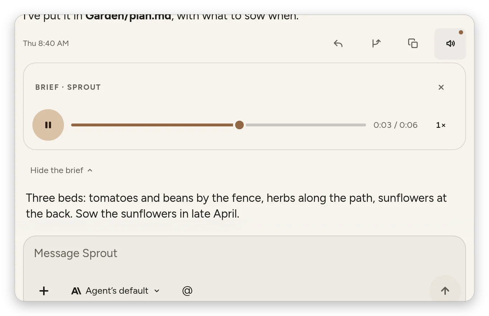
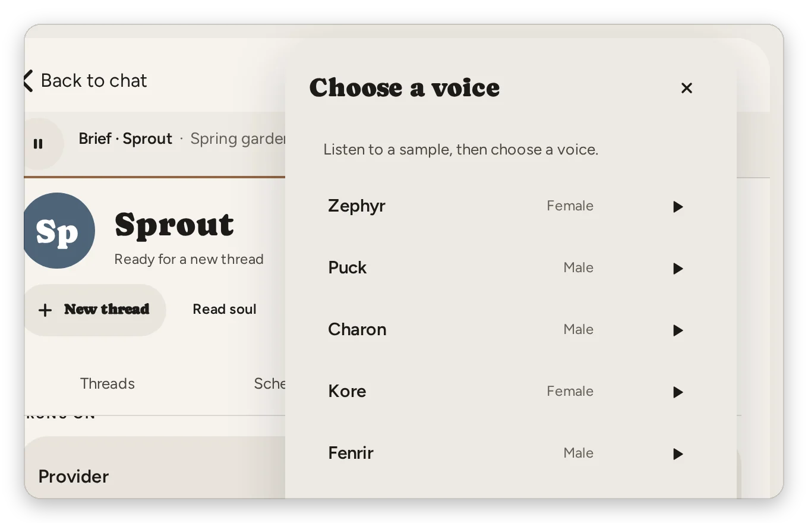
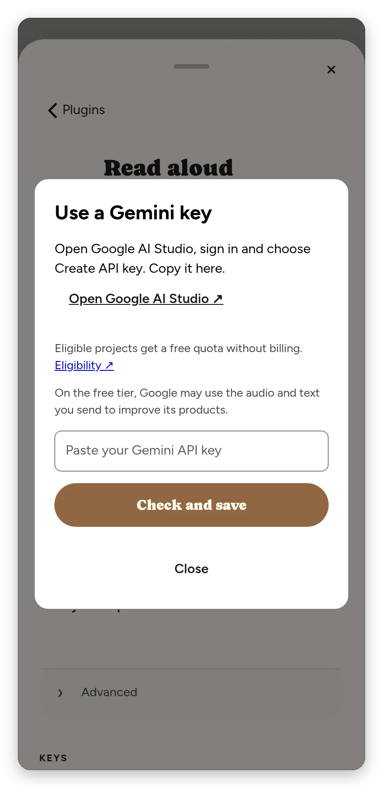

# Read aloud

<!-- loam:hero -->
**Listen to your agents instead of reading them, each in a voice of its own.**
<!-- /loam:hero -->

A plugin for [Loam](https://github.com/loamhq/loam). Press the speaker under
an agent's reply and hear it, or a short spoken summary of it, in the voice
you chose for that agent. Your notes in Files can be read aloud too.

<!-- loam:gallery -->

*Listen to any reply as written, or hear a short Brief of it.*


*It plays under the reply, and keeps going while you move around.*


*Choose a Google voice and hear its sample.*

*Add one shared Gemini key in Settings.*
<!-- /loam:gallery -->

## What you can do

- **Hear any reply.** Press Listen and it's read to you in the selected voice, or the device voice without a key.
- **Get the gist in seconds.** Brief turns a long reply into a short spoken
  summary.
- **Listen to your notes.** Any note in Files can be read aloud, and the
  player keeps going while you move around Loam.
- **A voice for each agent.** Google has thirty sampled voices. OpenAI maps those choices to its smaller voice set and shows the voice it will use. Files has a voice of its own.
- **Tables and diagrams, explained.** Instead of reading cells out, it tells
  you what they show (or skips them, if you prefer).

## How to use it

Press the speaker under a reply or in Files and choose Listen. With no key, the player uses your browser’s voice and reads the fixed skip notices for tables and diagrams. A server key adds Brief and generated descriptions.

Open Settings › Plugins › Read aloud to see the provider. When the plugin is using this browser, follow the free Gemini key link, sign in to Google AI Studio, create a key and paste it in the guide. Loam checks it and saves it in Settings › Connections › API keys for both plugins.

## What you need, and what leaves your server

Loam uses a Google key first, then an OpenAI key, then the browser. A provider error stays with that provider. Listen sends reply or file text to the selected provider. Browser voices can be local or use a browser-managed speech service. Server-generated audio is cached on your server. Browser speech is played on demand.

Eligible projects can use Google’s free quota without setting up billing. Google may use free-tier inputs and outputs to improve its products. Quotas vary by project and model. Google restricts API use to eligible regions and professional or business development. Serving users in the EEA, Switzerland or the UK requires paid services. [Google terms](https://aistudio.google.com/docs/terms) · [Available regions](https://aistudio.google.com/docs/available-regions) · [Project limits](https://aistudio.google.com/rate-limit)

---

Version 1.2 adds an optional OpenAI key and a connection to api.openai.com. Browser voices may contact their own speech service. Loam asks you to review this new access when updating.

## Technical details

### What it touches

- **api.openai.com** handles reply or file text for narration, summaries and descriptions when OpenAI is selected.
- **generativelanguage.googleapis.com** when Google is selected: the text of a reply or a note goes
  there from this plugin's own server on your Loam, which holds the key,
  only when you ask to hear it. The server supplies the key on that request.
- **Browser speech services** may receive text when the device voice needs a network connection.
- **Conversation records, read only**: the replies it reads.
- **Each agent's voice**, kept by your Loam with the agent's profile, so
  your agents can change it too.

### Settings

Settings › Plugins › Read aloud: when Listen and Brief are offered (Listen
from 50 words, Brief from 200, unless you change them), the reading rate, the
Files voice and whether tables and diagrams are described. They are kept in
this browser, so each device has its own, and they stay if you turn the
plugin off and on again. A take is made once and kept, so playing it again
is instant. Agent voices are on each agent's profile.

### Install from a link

In Settings › Plugins, with its link:

```
https://github.com/michaelhejazi/loam-read-aloud/tree/v1.2.1
```

### For builders

[PLUGIN.md](PLUGIN.md) is its manifest, with the voices as an
`agent_settings` field. Plain ES modules with no build step and no
dependency: `page/main.js` registers the reply footer, the Files action, the
player and the settings through Loam's plugin interface (API 0). `server/` is
its own small server (Node's standard library and `ffmpeg`), which Loam runs
while the plugin is on and reaches at `/x/read-aloud/`: it makes the speech,
keeps the audio for a while in the plugin's private folder, and holds the
key; the page holds none. Each agent's voice is the one chosen on its
profile, else the `voices` setting (`agent=Voice:character;…`, under
Advanced). `samples/` holds the voice samples the profile plays, one short
take per voice. Needs Loam 0.2.3 or later. Loam's own repository runs this
plugin's tests against its copy in `plugins/_listed/read-aloud/`. The
pictures are from Loam's demo world (`app/tools/capture-plugin-shots.mjs`;
the demo lowers Brief's threshold to 100 words).

## Made by

Michael Hejazi. Under the AGPL-3.0 ([LICENSE](LICENSE)), as Loam is.
