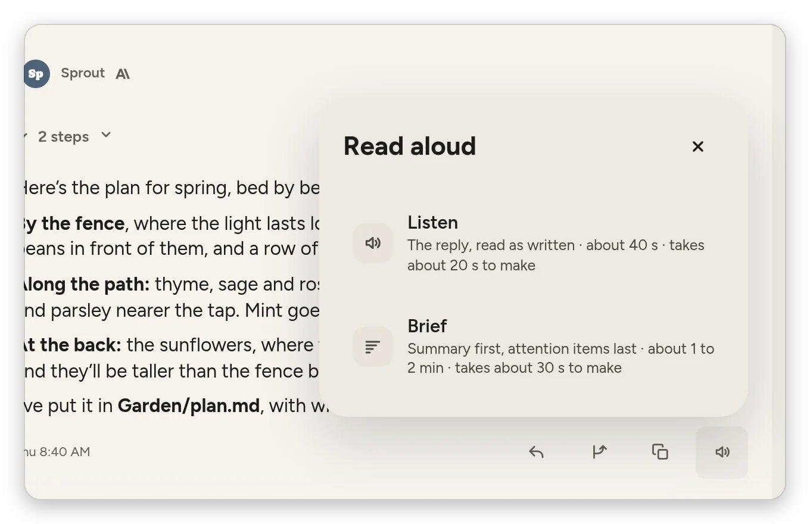

# Read aloud

<!-- loam:hero -->
**Listen to your agents instead of reading them, each in a voice of its own.**
<!-- /loam:hero -->

A plugin for [Loam](https://github.com/loamhq/loam). Press the speaker under
an agent's reply and hear it, or a short spoken summary of it, in the voice
you chose for that agent. Your notes in Files can be read aloud too.

<!-- loam:gallery -->

*Listen to any reply as written, or hear a short Brief of it.*


*It plays under the reply, and keeps going while you move around.*


*Give each agent a voice of its own; hear a sample first.*
<!-- /loam:gallery -->

## What you can do

- **Hear any reply.** Press Listen and it's read to you in that agent's own
  voice.
- **Get the gist in seconds.** Brief turns a long reply into a short spoken
  summary.
- **Listen to your notes.** Any note in Files can be read aloud, and the
  player keeps going while you move around Loam.
- **A voice for each agent.** Thirty to choose from, with a sample of each
  on the agent's profile. Files has a voice of its own.
- **Tables and diagrams, explained.** Instead of reading cells out, it tells
  you what they show (or skips them, if you prefer).

## How to use it

1. Get it from **Settings › Market › Read aloud**.
2. Add a Google (Gemini) key in **Settings › Connections › API keys**.
3. Press the speaker under a reply, then **Listen** or **Brief**.

## What you need, and what leaves your server

A Google (Gemini) API key, saved once in Loam (or one for Read aloud alone,
with "use a different key" on the same page). Without one, the controls say
that audio is unavailable and keep your choices for later.

The text of a reply or a note goes to Google from your own Loam server, only
when you press play, and your key never reaches the browser.

---

## Technical details

### What it touches

- **generativelanguage.googleapis.com**: the text of a reply or a note goes
  there from this plugin's own server on your Loam, which holds the key,
  only when you ask to hear it. The browser never sees the key.
- **Conversation records, read only**: the replies it reads.
- **Each agent's voice**, kept by your Loam with the agent's profile, so
  your agents can change it too.

### Settings

Settings › Plugins › Read aloud: when Listen and Brief are offered (Listen
from 50 words, Brief from 200, unless you change them), the reading rate, the
Files voice and whether tables and diagrams are described. They are kept in
this browser, so each device has its own, and they stay if you turn the
plugin off and on again. A take is made once and kept, so playing it again
is instant. Agent voices are on each agent's profile.

### Install from a link

In Settings › Plugins, with its link:

```
https://github.com/michaelhejazi/loam-read-aloud/tree/v1.1.3
```

### For builders

[PLUGIN.md](PLUGIN.md) is its manifest, with the voices as an
`agent_settings` field. Plain ES modules with no build step and no
dependency: `page/main.js` registers the reply footer, the Files action, the
player and the settings through Loam's plugin interface (API 0). `server/` is
its own small server (Node's standard library and `ffmpeg`), which Loam runs
while the plugin is on and reaches at `/x/read-aloud/`: it makes the speech,
keeps the audio for a while in the plugin's private folder, and holds the
key; the page holds none. Each agent's voice is the one chosen on its
profile, else the `voices` setting (`agent=Voice:character;…`, under
Advanced). `samples/` holds the voice samples the profile plays, one short
take per voice. Needs Loam 0.2.3 or later. Loam's own repository runs this
plugin's tests against its copy in `plugins/_listed/read-aloud/`. The
pictures are from Loam's demo world (`app/tools/capture-plugin-shots.mjs`;
the demo lowers Brief's threshold to 100 words).

## Made by

Michael Hejazi. Under the AGPL-3.0 ([LICENSE](LICENSE)), as Loam is.
